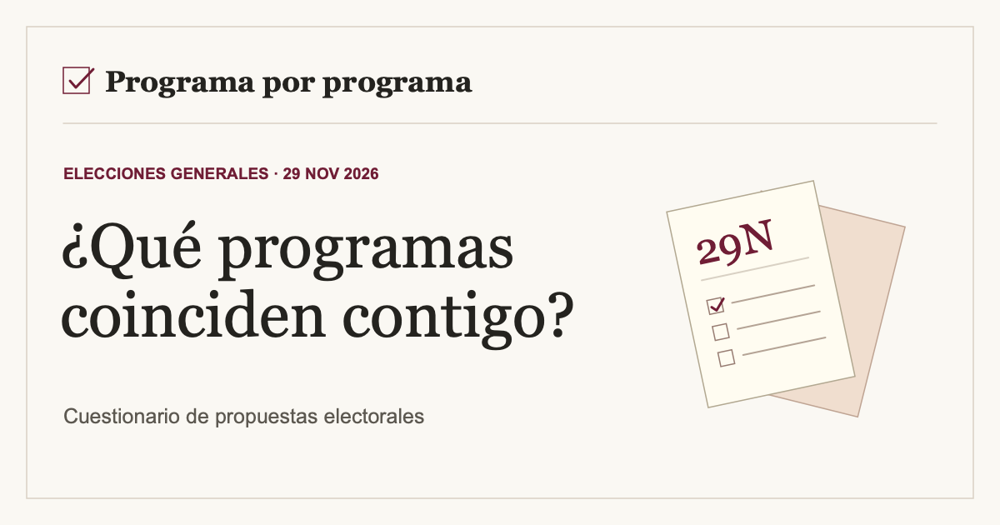

<div align="center">
  <h1>Programa por programa · 29N</h1>
  <p><strong>Compara propuestas. Consulta las fuentes. Saca tus propias conclusiones.</strong></p>
  <p></p>
  <p>
    <a href="https://programa-por-programa-29n.vercel.app/">Abrir el cuestionario</a> ·
    <a href="#arranque-local">Arranque local</a> ·
    <a href="#fuentes-y-método">Fuentes y método</a>
  </p>
</div>

Programa por programa es un cuestionario para comparar tus respuestas con medidas concretas de los programas electorales del 29N. Puedes elegir una circunscripción o consultar el conjunto de España, y abrir la fuente de cada coincidencia o discrepancia.

## Arranque local

Necesitas **Node.js 22.23.4 o posterior** y **pnpm 12.21.0** (la versión fijada en `package.json`). Desde la raíz del repositorio:

```bash
pnpm install --frozen-lockfile
pnpm dev
```

Abre [localhost:4321](http://localhost:4321).

| Comando | Qué hace |
| --- | --- |
| `pnpm build` | Genera el sitio estático en `dist/`. |
| `pnpm preview` | Sirve localmente la última compilación. |
| `pnpm test` | Compila y comprueba el sitio y los datos de fuentes sin depender de la red. |
| `pnpm test:e2e` | Compila y prueba el recorrido y el favicon en Firefox con Playwright. |
| `node scripts/comprobar-enlaces.mjs` | Valida las candidaturas, posiciones y referencias sin conexión. |
| `node scripts/comprobar-enlaces.mjs --enlaces` | Valida los datos y comprueba las fuentes públicas por red. |
| `node scripts/comprobar-enlaces.mjs --help` | Muestra la ayuda del comprobador. |

Para preparar las pruebas de navegador, instala Firefox una vez con `pnpm exec playwright install firefox`. Después ejecuta `pnpm test:e2e`. Si instalaste el navegador localmente con `PLAYWRIGHT_BROWSERS_PATH=0 pnpm exec playwright install firefox`, usa también `PLAYWRIGHT_BROWSERS_PATH=0 pnpm test:e2e`. Las pruebas sirven la compilación local y no necesitan visitar las fuentes externas.

La validación offline detecta identificadores duplicados, programas o posiciones de candidaturas desconocidas, posiciones inválidas y fuentes o localizadores faltantes. `pnpm test` también analiza la sintaxis original con Acorn para detectar claves de candidatura duplicadas antes de que JavaScript las sobrescriba; el comprobador independiente y el flujo programado no necesitan dependencias. Una candidatura puede no tener programa verificado y las siglas pueden faltar.

La auditoría de enlaces consulta cada URL única sin fragmento, secuencialmente, con pausas, un máximo de tres redirecciones y ocho segundos por enlace; cancela el cuerpo y no envía cookies ni credenciales. Solo usa IPv4 público, comprobado al conectar y en cada redirección; los hosts numéricos y puertos no estándar se rechazan. Los HTTP 404 y 410 se indican como **ausentes confirmados** y hacen fallar el comando; bloqueos, destinos rechazados, errores de red, tiempos agotados y otras respuestas no satisfactorias son **inconclusos**, no pruebas de ausencia. Los errores de datos también producen salida 1; una opción inválida produce salida 2. Las pruebas usan respuestas simuladas, no la red.

El flujo de GitHub Actions comprueba las fuentes semanalmente y permite ejecución manual solo en la rama predeterminada. Revisa los resultados antes de corregir datos: una respuesta inconclusa puede ser un bloqueo automático, no un enlace roto.

Para publicar la web, configura `pnpm build` como comando de compilación y `dist/` como directorio de salida. No hace falta un servidor Node.js en producción. Si cambia el dominio público, actualiza `site` en [`astro.config.mjs`](astro.config.mjs) para que la URL canónica y la vista previa social apunten al sitio correcto.

## Fuentes y método

- **Qué cuenta:** se comparan solo las respuestas «A favor» o «En contra» para las que el programa recoge una posición clara. Las omitidas no cuentan.
- **Cómo se lee el resultado:** 3 coincidencias de 4 respuestas comparables dan un 75 %. Sin respuestas comparables se muestra «Sin puntuación». El sondeo citado en la web solo determina el orden inicial, no el porcentaje.
- **Cómo revisar una comparación:** el detalle del resultado incluye la referencia al documento electoral. La web indica el corte documental utilizado: **19 de noviembre de 2026**.

> **Privacidad:** las respuestas y los resultados se quedan en la pestaña. El cuestionario no usa analítica, cookies ni almacenamiento persistente.

### Criterio documental

Solo se admite el texto del programa electoral del 29N de la candidatura: un original, una copia íntegra, un extracto directo o un contrato o lista de compromisos publicados como programa de esa campaña. Una noticia o nota de presentación no equivale al programa, aunque la publique la candidatura. Un documento genérico o compartido requiere acreditar su adopción para esa elección y candidatura. El BOE se usa solo para identificar las listas.

Cada registro cita la página, medida o apartado y resume el pasaje sin atribuirle más de lo que dice. Antes de añadir o cambiar una codificación, una segunda persona debe contrastarla por separado con el pasaje y el enunciado. Si discrepan, se conserva la evidencia y no se puntúa hasta resolver la interpretación. Los documentos pendientes de confirmar no aportan posiciones. Una URL admitida no certifica por sí sola todas sus interpretaciones.

## Mapa del repositorio

Astro genera el HTML y prepara los recursos. El cuestionario sigue funcionando con JavaScript en el navegador, sin API ni base de datos.

| Ruta | Contenido |
| --- | --- |
| [`src/pages/index.astro`](src/pages/index.astro) y [`src/layouts/BaseLayout.astro`](src/layouts/BaseLayout.astro) | Portada, secciones informativas y metadatos. |
| [`src/scripts/cuestionario.js`](src/scripts/cuestionario.js) | Navegación, catálogo, cálculo y detalle de los resultados. |
| [`src/data/candidaturas.js`](src/data/candidaturas.js) | Candidaturas por circunscripción y referencia al BOE. |
| [`src/data/programas.js`](src/data/programas.js) | Medidas, posiciones y referencias a los programas electorales. |
| [`src/styles/estilos.css`](src/styles/estilos.css) y [`public/`](public/) | Estilos globales e imagen para compartir la web. |

Si propones corregir una medida o una candidatura, indica la fuente y, cuando sea posible, la página o el apartado pertinente. Así se puede comprobar el cambio sin reconstruir toda la comparación.
